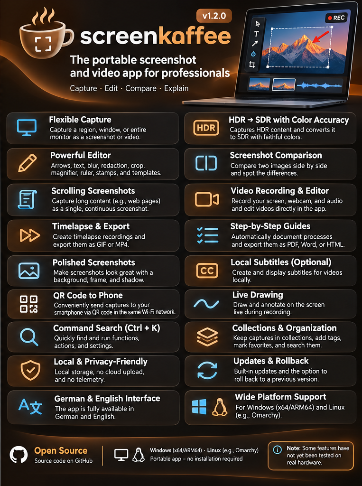

# screenkaffee

**English** · [Deutsch](README.md)

Portable screenshot and video app for Windows and Linux.
Goal: Windows and Omarchy/Hyprland, regular PNGs with correct SDR colors
on HDR desktops. The interface is available in English and German. Version **1.2.0**.

**Some features have not yet been tested on real hardware.** The exact status is listed in [FEATURES.md](FEATURES.md) (German).

**⬇ Direct download:** [Windows (x64)](https://github.com/Strugglechen1337/screenkaffee/releases/latest/download/screenkaffee-Windows-x64.zip) · [Windows ARM64](https://github.com/Strugglechen1337/screenkaffee/releases/latest/download/screenkaffee-Windows-arm64.zip) · [Linux x86_64](https://github.com/Strugglechen1337/screenkaffee/releases/latest/download/screenkaffee-Linux-x86_64.tar.gz) · [all releases](https://github.com/Strugglechen1337/screenkaffee/releases/latest)

Extract the ZIP (right-click → "Extract All") and start **`screenkaffee.exe`** in the `screenkaffee` folder. The "Untertitel" (subtitle add-on) files in a release are downloaded by the app itself when needed.



## Language

On first start screenkaffee asks which language to use (English or German). You can change it anytime under
**Settings → "Sprache / Language"**: Automatic (system language), Deutsch or English. The app restarts to apply
the change. Release notes and the developer documentation are written in German.

## Windows without installation (x64 & ARM64)

Extract `screenkaffee-Windows-x64.zip` (or `screenkaffee-Windows-arm64.zip` on Snapdragon/ARM64 devices)
and start `screenkaffee/screenkaffee.exe`. Keep the whole folder together; Python and Qt are included.
No administrator rights and no system-wide installation are required.
For development, `Start-screenkaffee.cmd` starts the local environment instead.

Supported: Windows 10 1903 or later / Windows 11 (x64 and ARM64) with working
Windows Graphics Capture.

## Omarchy without installation

Extract `screenkaffee-Linux-x86_64.tar.gz`, change into the folder and start it:

```sh
tar -xzf screenkaffee-Linux-x86_64.tar.gz
cd screenkaffee
./screenkaffee
```

Python and Qt are included in the archive; nothing is downloaded at startup. Target is x86_64
with glibc >= 2.34 and the usual desktop/graphics libraries. **The Linux package
is built on Windows and has not yet been run on Omarchy.**

On Hyprland the app uses the installed `grim` and `slurp`, and `hyprctl` for windows.
Without these tools the XDG screenshot portal is used as a fallback on Wayland.
Depending on the desktop, its dialog offers region/window selection.
No Hyprland settings are changed automatically.

Hotkey commands, also while the app is running:

```sh
/absolute/path/screenkaffee/screenkaffee --capture region
/absolute/path/screenkaffee/screenkaffee --capture screen
/absolute/path/screenkaffee/screenkaffee --capture window
```

Bind these commands in the keyboard shortcut settings of your Omarchy version.
Newer Omarchy versions partly use Lua configuration, older ones the classic
Hyprland syntax. The app does not change existing Print Screen bindings.

## HDR colors

On Windows, captures use Windows Graphics Capture in FP16 scRGB. For each
HDR monitor the current SDR white level is read via DisplayConfig. Only then
are the linear pixels normalized and converted with the sRGB transfer function
into 8-bit PNGs. PNGs contain an sRGB ICC profile.

- **Keep SDR colors** (default): SDR colors and white are preserved;
  HDR highlights beyond the SDR range are clipped.
- **Compress bright details**: fixed highlight curve; bright details keep
  their gradation, SDR white becomes slightly darker. No automatic exposure adjustment.

A regular SDR PNG cannot reproduce the peak brightness of an HDR display. The app
aims for SDR colors that don't look washed out, not for true HDR image files. Windows HDR
has been checked on a real HDR display.

On Linux the compositor delivers the image. An embedded ICC profile is converted
to sRGB; untagged images are treated as sRGB.
**Whether grim/portal tone-map correctly with your Omarchy HDR configuration is still open.**

## Basics

- Capture a region, monitor or window; delay up to 30 seconds.
- Windows: `Print Screen` (global); in the workspace also `Ctrl+N`. Custom shortcuts under Settings.
- Closing or minimizing hides the workspace in the system tray. Open it again from the tray icon; use its "Quit" menu entry to exit completely.
- Double-click a capture to open the Editor.
- Tools include arrow, line, rectangle, ellipse, text, step numbers, highlighter,
  blur, pixelate, redact, crop, color picker, magnifier, stamps, templates and ruler.
- Select tool: move annotations, double-click text to edit, `Del` removes annotations,
  `Ctrl+Z` / `Ctrl+Y` for undo/redo. Arrange annotations (bring to front/send to back with
  `Ctrl+Page Up/Down`), lock, align and distribute them; arrow keys nudge by 1 px (Shift: 10 px).
- `Ctrl+mouse wheel` zooms. "Save project" keeps annotations editable.
- Select several overlapping scrolling captures and stitch them (oldest first).
- Search finds captures by title, tags, window, app, URL and subtitle text. Mark favorites with a star –
  they are never removed by clean-up.
- Deleted captures go to the **Trash** in the collection bar (F10), where you can restore them,
  delete them permanently or empty the Trash.

## Data and optional tools

By default everything is stored in `data/` next to the portable app: captures,
SQLite database, projects, videos, settings and error log.
Use `--data-dir /path` or `SCREENKAFFEE_DATA` for a different folder.
The app folder must be writable.

## Updates

"More → Help and updates → Check for updates…" asks GitHub for the latest release, downloads the
matching package (Windows x64, Windows ARM64 or Linux x86_64), verifies its SHA256 checksum
and replaces the program files. `data/` is never touched. screenkaffee then restarts and shows
once what's new. The previous version is kept in `_previous/` (can be turned off, about 0.7 GB) and
can be brought back via "Restore previous version…"; automatic updates are turned off in that case.
Under Settings → Updates you can choose: off (default), check at startup and ask, or install
automatically at startup. If an Editor, a capture or a video is running, the update is installed on exit.
The updater needs no account and no token; it only reads the public releases. Versions before 0.7.0
have no updater and must be replaced by hand once.

## Pin, setup, error report

- **Pin:** right-click a capture (or "More image actions" in the Editor) → "Pin (always on top)".
  The image floats on top: drag to move, mouse wheel to zoom, right-click for opacity/copy,
  Esc or double-click closes it.
- **Setup:** on first start screenkaffee asks for language, capture key, autostart and updates.
  On Linux/Omarchy it shows the ready-made line for `hyprland.conf`.
- **Error report:** on an unexpected error a window with "Copy report" appears
  (version, system, error message; no images, user folders anonymized).

## Beautify, key presses, subtitle add-on

- **Beautify:** right-click a capture (or "More image actions" in the Editor) → "Beautify (background, frame)…".
  Gradient background, rounded corners, soft shadow and optionally a window frame with title; format
  matching the image or 16:9, 4:3, 1:1, 9:16. Copy the result or save it as a new capture.
- **Key presses in videos (Windows):** "Show key presses" in the video dialog. By default only
  combinations such as "Ctrl + C" and special keys are shown – normal typing stays invisible so that
  passwords don't end up in the video. "All keys (including typed text)" shows typing as well.
  On Linux/Wayland apps cannot read other programs' key presses.
- **Subtitle add-on:** local speech recognition (Whisper model and libraries, about 190 MB download,
  220 MB on Linux) is not part of the main package. The first time you use "Generate subtitles locally",
  screenkaffee offers to download it from the GitHub release of the running version, verifies the
  SHA256 checksum and stores it in `data/addons/`. Not available on Windows ARM64; opening, editing
  and embedding SRT files works everywhere.

## Tour of the best features

On first start (after setup) screenkaffee shows a short tour once: the window is dimmed, the explained
button stays bright, with a speech bubble next to it. Open it again via
"More → Help and updates → Tour: the best features…" or Ctrl+K → "Tour".

## Step guide, command search, live draw, ruler, templates, clean-up

- **Step guide (Windows):** "More → Capture → Record step guide…". Then simply click through your workflow:
  every mouse click becomes an image with the click position marked in red and numbered. A small bar at the
  top of the screen offers "Done" and "Cancel" (it never appears in the images). The steps are saved in their
  own collection and the document designer opens with "Step 1, 2, 3 …" – save as PDF, Word or HTML.
- **Command search (Ctrl+K):** one search box for every feature. Type "time", press Enter – done.
- **Live draw (Ctrl+Alt+D):** draw arrows, rectangles, ellipses, pen and highlighter strokes directly on
  the screen, e.g. while recording a video. Strokes fade after 3 seconds; H keeps them. Esc or Ctrl+Alt+D ends it.
- **Ruler:** press L in the region selection (or "More → Capture → Measure the screen (ruler)") and drag a line:
  length, width, height and angle in real screen pixels. Shift snaps horizontally/vertically/45°, Ctrl+C copies
  the measurements. The Editor has the same as the "Ruler" tool.
- **Templates:** in the Editor "More image actions → Templates" – "Click here", "Important (border)",
  "Step with explanation" or your own ("Save selection as template…").
- **Clean up:** "More → Collections and data → Clean up (duplicate images, large videos)…" finds duplicate
  and very similar images as well as large or old videos and shows how much space you can free.
  Checked items go to the Trash (restorable); "Empty Trash" frees the space permanently.

## Compare, send to phone, time-lapse

- **Compare:** select two image captures (Ctrl+click) → right-click "Compare". The older one is on the left.
  Views: slider, blend or "Highlight differences" (unchanged areas lightened, differences outlined in red).
- **Send to phone:** right-click → "Send to phone (QR code)…". Scan the code with your phone camera; the phone
  opens a page with a preview and "Download". PC and phone must be on the same Wi-Fi. A small web server only runs
  while the window is open (at most 15 minutes), only on a private network address with a random path;
  nothing goes to the internet. Windows Firewall may ask the first time: allow "Private networks".
- **Time-lapse:** "More → Start time-lapse…". Monitor, region or last region; one image every 1–600 seconds,
  video at 5–60 frames/s. Stop via the tray icon, "Stop time-lapse" or `--capture timelapse`.
  The MP4 ends up in the workspace.

**Redaction:** in the exported PNG, redacted pixels are replaced. The unchanged original and the editable
project stay on your computer. To share, use the exported PNG file, not the whole data/project folder.

No automatic cloud uploads, no telemetry, no autostart unless you enable it.

## Development / build

```powershell
py -3.12 -m venv .venv
.\.venv\Scripts\python.exe -m pip install -r requirements.txt pytest pyinstaller
.\.venv\Scripts\python.exe -m pytest -q
.\.venv\Scripts\python.exe -m scripts.package_windows
.\.venv\Scripts\python.exe -m scripts.package_linux
```

Diagnostics without storing image data:

```powershell
.\.venv\Scripts\python.exe -m screenkaffee --diagnose
.\.venv\Scripts\python.exe -m screenkaffee --self-test --data-dir .tools/smoke-data
```

UI texts are German in the source code and translated via `screenkaffee/i18n.py`; English texts live in
`screenkaffee/i18n_en/`. `scripts/i18n_check.py` lists missing translations.

License: own code MIT. Third-party information: [THIRD_PARTY.md](THIRD_PARTY.md).
