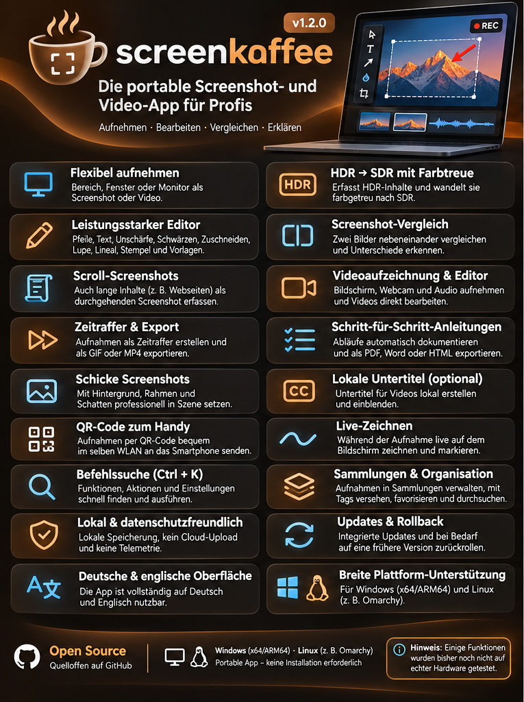

# screenkaffee

[English](README.en.md) · **Deutsch**

Portable Screenshot- und Video-App für Windows und Linux.
Ziel: Windows und Omarchy/Hyprland, normale PNGs mit korrekter SDR-Farbwiedergabe
auf HDR-Desktops. Oberfläche auf Deutsch und Englisch. Version **1.2.0**.

*Portable screenshot and video app for Windows and Linux – interface in English and German. **[Read this in English](README.en.md).***

**Einige Funktionen sind noch nicht auf echter Hardware abgenommen.** Der genaue Stand steht in [FEATURES.md](FEATURES.md).

**[⬇ Neueste Version herunterladen](https://github.com/Strugglechen1337/screenkaffee/releases/latest)**



## Windows ohne Installation (x64 & ARM64)

`dist/screenkaffee-Windows-x64.zip` (bzw. auf Snapdragon-/ARM64-Geräten `dist/screenkaffee-Windows-arm64.zip`)
entpacken und `screenkaffee/screenkaffee.exe` starten. Der gesamte Ordner muss zusammenbleiben; Python und Qt werden mitgeliefert.
Es werden keine Administratorrechte und keine systemweite Installation benötigt.
Für die Entwicklung startet `Start-screenkaffee.cmd` alternativ die lokale Umgebung.

Unterstütztes Ziel: Windows 10 ab 1903 / Windows 11 (x64 sowie ARM64), funktionierendes
Windows Graphics Capture. Auf diesem Rechner mit aktiver SDR-Anzeige getestet.

## Omarchy ohne Installation

`dist/screenkaffee-Linux-x86_64.tar.gz` entpacken, in den Ordner wechseln und starten:

```sh
tar -xzf screenkaffee-Linux-x86_64.tar.gz
cd screenkaffee
./screenkaffee
```

Python und Qt liegen im Archiv; der Start lädt keine Pakete nach. Ziel ist x86_64
mit glibc >= 2.34 und den normalen Desktop-/Grafikbibliotheken. **Das Linux-Paket
wurde auf Windows zusammengestellt und noch nicht unter Omarchy ausgeführt.**

Auf Hyprland verwendet die App vorhandenes `grim` und `slurp`, für Fenster
`hyprctl`. Ohne diese Programme steht auf Wayland das XDG-Screenshot-Portal als
Fallback bereit. Je nach Desktop erlaubt dessen Dialog die Bereichs-/Fensterauswahl.
Es werden keine Hyprland-Einstellungen automatisch geändert.

Hotkey-Aufruf, auch wenn die App bereits läuft:

```sh
/absoluter/pfad/screenkaffee/screenkaffee --capture region
/absoluter/pfad/screenkaffee/screenkaffee --capture screen
/absoluter/pfad/screenkaffee/screenkaffee --capture window
```

Diesen Befehl über die Tastenkürzel-Einstellung deiner Omarchy-Version binden.
Neuere Omarchy-Versionen nutzen teils Lua-Konfiguration, ältere die klassische
Hyprland-Syntax. Die App verändert vorhandene Druck-Tasten-Belegungen nicht.

## HDR-Farben

Windows wird über Windows Graphics Capture in FP16-scRGB aufgenommen. Für jeden
HDR-Monitor wird der aktuelle SDR-Weißpegel über DisplayConfig ermittelt. Erst
danach werden die linearen Pixel normiert und mit der sRGB-Transferfunktion
in 8-Bit-PNGs überführt. PNGs enthalten ein sRGB-ICC-Profil.

- **SDR-Farben erhalten** (Standard): SDR-Farben und Weiß bleiben erhalten;
  HDR-Spitzlichter außerhalb des SDR-Bereichs werden begrenzt.
- **Helle Details komprimieren**: feste Highlight-Kurve; helle Details erhalten
  Abstufungen, dafür wird SDR-Weiß etwas dunkler. Keine automatische Bildbelichtungsanpassung.

Ein normales SDR-PNG kann die maximale Helligkeit eines HDR-Displays nicht
reproduzieren. Die App zielt auf unverwaschene SDR-Farben, nicht auf echte
HDR-Bilddateien. Die Normierung ist automatisiert getestet; die sichtbare
Farbübereinstimmung auf echter HDR-Hardware ist noch zu prüfen.

Unter Linux liefert der Compositor das Bild. Ein eingebettetes ICC-Profil wird
in sRGB umgerechnet; unprofilierte Bilder werden als sRGB interpretiert.
Es wird keine Windows-scRGB-Korrektur auf ein bereits gerendertes PNG angewandt.
**Ob grim/Portal unter deiner Omarchy-HDR-Konfiguration korrekt tonemappt, ist offen.**

## Bedienung

- Bereich, Monitor oder Fenster aufnehmen; Verzögerung bis 30 Sekunden.
- Windows: `Druck` (global); im Workspace zusätzlich `Strg+N`. Eigene Kürzel unter Einstellungen.
- X und Minimieren verbergen den Workspace im Infobereich neben der Uhr. Über das Tray-Symbol wieder öffnen; über dessen Menü „Beenden“ vollständig schließen. Ohne verfügbaren Tray wird das Fenster nicht unsichtbar im Hintergrund abgelegt.
- Doppelklick auf eine Aufnahme öffnet den Editor.
- Werkzeuge: Pfeil, Linie, Rechteck, Ellipse, Text, Schrittzahlen, Marker,
  Unschärfe, Schwärzen, Zuschnitt, Farbpipette.
- Auswahlwerkzeug: Markierungen verschieben; Text per Doppelklick ändern;
  `Entf` entfernt Markierungen; `Strg+Z` / `Strg+Y` für Undo/Redo.
- `Strg+Mausrad` zoomt. „Projekt speichern“ erhält bearbeitbare Markierungen.
- PNG-Export / Kopieren / Dokumentexport verwenden gespeicherte Markierungen.
  Noch ungespeicherte Editoränderungen direkt aus dem Editor exportieren.
- Mehrere manuell überlappend aufgenommene Scrollbilder auswählen und verbinden.
  Reihenfolge: älteste zuerst. Feste Kopf-/Fußleisten ggf. vorher zuschneiden.
- Titel, Tags und Sammlungen über „Mehr“ bearbeiten. Suche durchsucht Titel und Tags.

## Daten und optionale Werkzeuge

Alles liegt standardmäßig in `data/` neben der portablen App: Aufnahmen,
SQLite-Datenbank, Projekte, Videos, Einstellungen und Fehlerprotokoll.
Für einen anderen Ordner `--data-dir /pfad` oder `SCREENKAFFEE_DATA` verwenden.
Der App-Ordner muss schreibbar sein. Beim Entfernen landen Dateien in `data/trash/`.

## Updates

„Mehr → Nach Updates suchen …“ fragt das neueste GitHub-Release ab, lädt das
passende Paket (Windows x64, Windows ARM64 oder Linux x86_64), prüft die SHA256-Summe
und tauscht die Programmdateien aus. `data/` bleibt dabei unberührt. Danach startet
screenkaffee neu und zeigt einmal, was neu ist. Die vorige Version wird in `_previous/`
aufbewahrt (abschaltbar, ca. 0,7 GB) und lässt sich über „Mehr → Vorige Version
wiederherstellen …“ zurückholen; automatische Updates werden dabei ausgeschaltet. Unter Einstellungen → Updates lässt sich wählen:
aus (Standard), beim Start prüfen und nachfragen, oder beim Start automatisch
installieren. Läuft gerade ein Editor, eine Aufnahme oder ein Video, wird das Update
beim Beenden installiert. Der Updater braucht kein Konto und kein Token; er liest nur die
öffentlichen Releases. Versionen vor 0.7.0 haben noch keinen Updater und müssen einmal von
Hand ersetzt werden.

## Anheften, Einrichtung, Fehlerbericht

- **Anheften:** Rechtsklick auf eine Aufnahme (oder im Editor „Weitere Bildaktionen“) →
  „Anheften“. Das Bild schwebt dann immer im Vordergrund: ziehen verschiebt, Mausrad zoomt,
  Rechtsklick für Deckkraft/Kopieren, Esc oder Doppelklick schließt.
- **Einrichtung:** Beim ersten Start fragt screenkaffee nach Aufnahmetaste, Autostart und
  Updates. Unter Linux/Omarchy zeigt es die fertige Zeile für `hyprland.conf`. Später erneut
  über „Mehr → Einrichtung …“.
- **Fehlerbericht:** Bei einem unerwarteten Fehler erscheint ein Fenster mit „Bericht kopieren“
  (Version, System, Fehlermeldung; keine Bilder, Benutzerordner anonymisiert).

## Schicker Screenshot, Tastendrücke, Untertitel-Erweiterung

- **Schicker Screenshot:** Rechtsklick auf eine Aufnahme (oder im Editor „Weitere Bildaktionen“) →
  „Schicker Screenshot …“. Farbverlauf als Hintergrund, abgerundete Ecken, weicher Schatten und auf
  Wunsch ein Fensterrahmen mit Titel; Format passend zum Bild oder 16:9, 4:3, 1:1, 9:16. Ergebnis
  kopieren oder als neue Aufnahme speichern. Der zuletzt gewählte Stil wird gemerkt.
- **Tastendrücke im Video (Windows):** Im Videodialog „Tastendrücke einblenden“. Standard: nur
  Kombinationen wie „Strg + C“ und Sondertasten (Eingabe, Esc, F-Tasten, Pfeile) – normales Tippen
  bleibt unsichtbar, damit z. B. Passwörter nicht im Video landen. „Alle Tasten“ zeigt auch Getipptes.
  Unter Linux/Wayland können Programme fremde Tastendrücke nicht mitlesen.
- **Untertitel-Erweiterung:** Die lokale Untertitel-Erkennung (Whisper-Modell und Bibliotheken, ca.
  190 MB Download, unter Linux 220 MB) steckt nicht mehr im Paket. Beim ersten „Untertitel lokal erzeugen“ bietet
  screenkaffee sie an, lädt sie aus dem GitHub-Release der laufenden Version,
  prüft die SHA256-Summe und legt sie in `data/addons/` ab. Nach Updates wird sie ohne neuen Download
  wieder eingebunden, solange sie passt. Entfernen unter Einstellungen → Updates. Auf Windows ARM64 gibt
  es keine Erkennung; SRT öffnen, bearbeiten und einbetten geht überall.

## Tour durch die besten Funktionen

Beim ersten Start (nach der Einrichtung) zeigt screenkaffee einmal eine kurze Tour: Das Fenster wird abgedunkelt, die erklärte Schaltfläche bleibt hell, daneben steht eine Sprechblase. Zehn Schritte – Aufnehmen, Befehlssuche (Strg+K), Screenshots vergleichen, Editor, Schicker Screenshot und aufs Handy senden, Video, Schritt-Anleitung, Live-Zeichnen und Lineal, Version und Updates. Pfeiltasten blättern, Esc beendet. Wieder aufrufen: „Mehr → Hilfe und Updates → Tour: die besten Funktionen …“ oder Strg+K → „Tour“.

## Schritt-Anleitung, Befehlssuche, Live-Zeichnen, Lineal, Vorlagen, Aufräumen

- **Schritt-Anleitung (Windows):** „Mehr → Aufnehmen → Schritt-Anleitung aufnehmen …“. Danach einfach durch den Ablauf klicken: Jeder Mausklick wird ein Bild mit rot markierter Klickstelle und Nummer. Oben am Bildschirm steht eine kleine Leiste mit „Fertig“ und „Abbrechen“ (sie erscheint selbst nicht auf den Bildern). Die Schritte landen in einer eigenen Sammlung „Anleitung …“, und der Dokument-Designer öffnet sich mit „Schritt 1, 2, 3 …“ und einer Beschreibung je Schritt – als PDF, Word oder HTML speichern. Unter Linux/Wayland nicht möglich (Klicks in anderen Programmen sind dort nicht sichtbar).
- **Befehlssuche (Strg+K):** Ein Suchfeld für alle Funktionen. „zeitr“ tippen, Enter – fertig. Umlaute dürfen als ae/oe/ue getippt werden.
- **Live-Zeichnen (Strg+Alt+D):** Pfeile, Rechtecke, Ellipsen, Stift und Marker direkt auf den Bildschirm malen, z. B. während einer Videoaufnahme. Striche verblassen nach 3 Sekunden; H lässt sie stehen. Tasten: P/A/R/E/M Werkzeug, 1–5 Farbe, Rücktaste rückgängig, Entf alles weg, Esc oder Strg+Alt+D beendet. Solange es aktiv ist, gehen Klicks ans Zeichnen, nicht an die Programme darunter.
- **Lineal:** In der Bereichsauswahl L drücken (oder „Mehr → Aufnehmen → Bildschirm ausmessen“) und eine Linie ziehen: Länge, Breite, Höhe und Neigung in echten Bildschirmpixeln, mit Hilfslinien. Umschalt rastet waagerecht/senkrecht/45° ein, Strg+C kopiert die Maße. Im Editor gibt es dasselbe als Werkzeug „Lineal“ (unten in der Werkzeugleiste); es kommt nicht ins Bild.
- **Vorlagen:** Im Editor „Weitere Bildaktionen → Vorlagen“ – „Hier klicken“ (Pfeil + Text), „Wichtig (Rahmen)“, „Neu“, „Schritt mit Erklärung“ oder eigene: Markierungen auswählen → „Auswahl als Vorlage speichern …“. Vorlagen bleiben bearbeitbare Markierungen (Text per Doppelklick ändern). Bildstempel wie ein Logo weiterhin über die Stempelbibliothek.
- **Aufräumen:** „Mehr → Sammlungen und Daten → Aufräumen …“ findet doppelte und sehr ähnliche Bilder (das neueste bleibt, die anderen sind vorab angekreuzt) sowie große oder über 90 Tage alte Videos und zeigt, wie viel Platz frei wird. Angekreuztes kommt in den Papierkorb (wiederherstellbar); „Papierkorb leeren“ gibt den Platz endgültig frei.

## Vergleichen, aufs Handy senden, Zeitraffer

- **Vergleichen:** Zwei Bildaufnahmen auswählen (Strg+Klick) → Rechtsklick „Vergleichen“.
  Die ältere steht links. Ansichten: Schieberegler (Trennlinie mit der Maus ziehen, ←/→),
  Überblenden oder „Unterschiede markieren“ (Unverändertes aufgehellt, Abweichungen rot
  umrandet). Die Toleranz ignoriert leichtes Kompressionsrauschen. Die Markierung lässt sich
  als neue Aufnahme speichern.
- **Aufs Handy senden:** Rechtsklick → „Aufs Handy senden (QR-Code) …“. Den Code mit der
  Handykamera scannen; das Handy öffnet eine Seite mit Vorschau und „Herunterladen“. PC und
  Handy müssen im selben WLAN sein. Ein kleiner Webserver läuft nur, solange das Fenster offen
  ist (höchstens 15 Minuten), nur unter einer privaten Netzwerkadresse und einem zufälligen
  Pfad; nichts geht ins Internet. Beim ersten Mal fragt die Windows-Firewall eventuell nach:
  „Private Netzwerke“ erlauben. Per Richtlinie `NoLanShare` abschaltbar.
- **Zeitraffer:** „Mehr → Zeitraffer starten …“. Monitor, Bereich oder letzter Bereich; ein Bild
  alle 1–600 Sekunden, Video mit 5–60 Bildern/s (Standard: alle 5 s, 30 Bilder/s → 1 Stunde
  wird 24 Sekunden). Stoppen über das Tray-Symbol, „Mehr → Zeitraffer stoppen“, die optionale
  Taste oder `--capture timelapse`. Das MP4 landet im Arbeitsbereich.

**Schwärzen:** Im exportierten PNG sind geschwärzte Pixel ersetzt. Das unveränderte
Original und bearbeitbare Projekt bleiben lokal erhalten. Zum Weitergeben die
exportierte PNG-Datei verwenden; nicht den gesamten Daten-/Projektordner.

Die aktuellen Pakete liefern Python, Qt, FFmpeg, QR-Erkennung und PDF-Rendering mit; die lokale Untertitel-Erkennung (Whisper) wird bei Bedarf nachgeladen. Beim Start werden keine Modelle heruntergeladen.

Zusätzliche Systemwerkzeuge werden zuerst unter `tools/`, dann im PATH gesucht:

- Omarchy: `grim`, `slurp`, `hyprctl`; Video bevorzugt `gpu-screen-recorder`, alternativ `wf-recorder`.
- Android: `adb` ist noch nicht mitgeliefert. USB-Debugging muss am echten Gerät bestätigt sein.
- Audio/Webcam: native Geräte sind auswählbar; die Abnahme mit echten Geräten steht aus.

Keine automatischen Cloud-Uploads, keine Telemetrie, kein Autostart.

## Entwicklung / Build

```powershell
py -3.12 -m venv .venv
.\.venv\Scripts\python.exe -m pip install -r requirements.txt pytest pyinstaller
.\.venv\Scripts\python.exe -m pytest -q
.\.venv\Scripts\python.exe -m scripts.package_windows
.\.venv\Scripts\python.exe -m scripts.package_linux
```

Alternativ `scripts/build-windows.ps1` ausführen. Linux-Paketierung lädt einen
offiziellen relocatablen Python-Build mit SHA256-Prüfung und Linux-Wheels herunter;
das fertige Paket benötigt beim Start kein Netz. Die Paketierung ersetzt keinen
Linux-Laufzeittest.

Diagnose ohne gespeicherte Bilddaten:

```powershell
.\.venv\Scripts\python.exe -m screenkaffee --diagnose
.\.venv\Scripts\python.exe -m screenkaffee --self-test --data-dir .tools/smoke-data
.\.venv\Scripts\python.exe -m scripts.native_capture_check
```

`native_capture_check` zeigt eine synthetische Farbtafel und vergleicht bekannte
RGB-Werte mit der GPU-Aufnahme. Es speichert nur Zahlen, keine Bildschirmbilder.

Lizenz: eigener Code MIT. Drittanbieterinformationen: [THIRD_PARTY.md](THIRD_PARTY.md).

Aktuelle Ergänzungen und verbleibende Einschränkungen: [FEATURES.md](FEATURES.md). Video-Zoom wird während der Aufnahme gesteuert und beim Speichern berechnet; Rohvideos bleiben erhalten. Manuelle Scrollserie: Strg+Alt+F7/F8. Unter Omarchy stehen die Aktionen auch über `--capture zoom-in`, `zoom-out`, `zoom-reset`, `scroll-frame` und `scroll-finish` zur manuellen Hotkey-Anbindung bereit.
